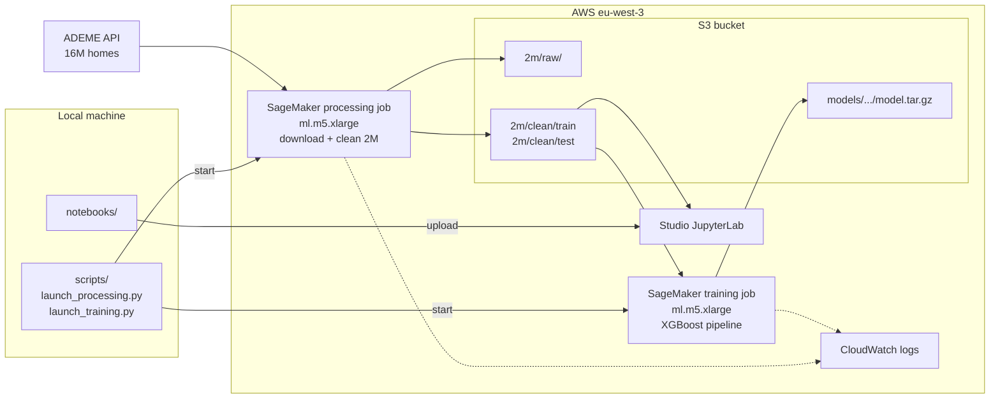
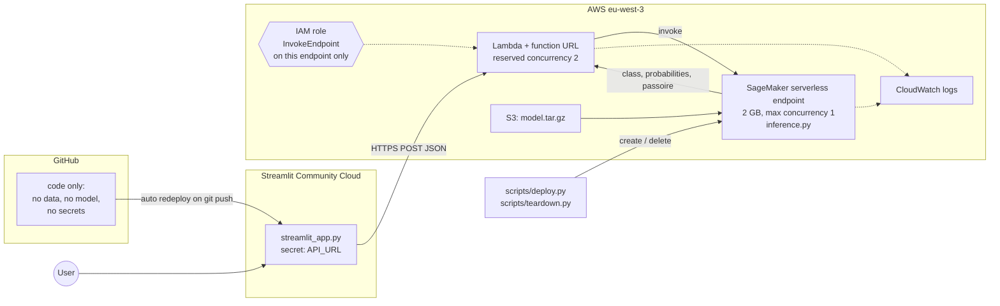
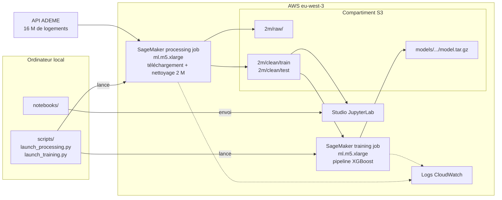
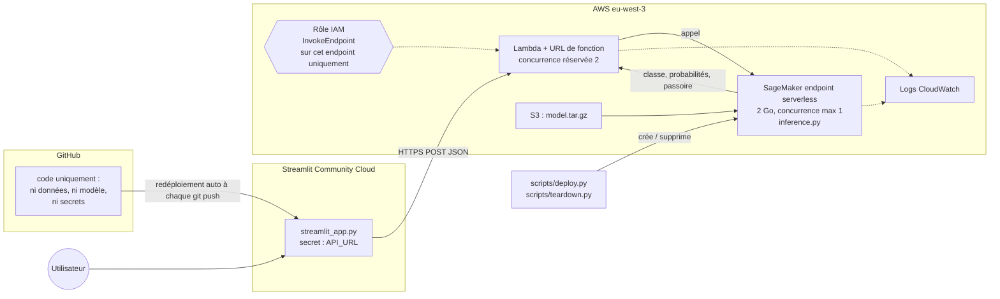

# thermal-leak-detector

Estimate a home's French energy rating (DPE, A to G) from simple facts, without a diagnosis.

**Demo:** https://thermal-leak-detector-france.streamlit.app/

## Architecture

### Training



### Prediction



- Preprocessing inside the model (scikit-learn pipeline): the endpoint takes raw JSON
- Lambda role: `sagemaker:InvokeEndpoint` on this endpoint only
- Endpoint: max concurrency 1, scales to zero when idle

## Data

- DPE existing homes (since July 2021), ADEME, data.gouv.fr
- 2,000,000 homes sampled at random out of 16 million, all of France
- 1,844,037 after cleaning: 1,475,229 training, 368,808 test

## Cleaning

- whole buildings removed
- living area: 9 to 500 m² (9 m²: legal minimum)
- ceiling height: 2.2 to 5 m
- heating equipment: 130 types grouped into 7 families + unknown
- January 1st 2026 rule change: `apres_2026` column, always 1 at prediction time

## Excluded columns (answer leakage)

- energy consumption, CO₂ emissions, GHG label
- energy costs
- technical details: insulation, windows, heat losses

## Results

| | Baseline | Model, 221k rows (local) | Model, 1.5M rows (SageMaker) |
|---|---|---|---|
| Exact class | 44.4% | 47.9% | 48.7% |
| Within one class | 86.4% | 86.5% | 87.1% |
| F1 macro | 0.28 | 0.42 | 0.43 |
| Passoire (F/G) recall | 24.7% | 43.6% | 42.3% |
| Passoire (F/G) precision | 52.6% | 44.9% | 45.9% |

- Baseline: most frequent class per (construction period × heating energy)
- Model: XGBoost in a scikit-learn pipeline, softened class weights, tuned hyperparameters

## Findings

- 100k → 221k training rows: +0.2 points accuracy
- 221k → 1.5M training rows: +0.8 points accuracy
- Hyperparameter tuning: +0.7 F1 points
- The limit comes from the available information, not the amount of data or the model

## Limitations

- No information on insulation, windows or renovation work: two identical-looking homes can have different ratings
- Rare classes (A, B, G) are harder to predict
- The DPE itself has known reliability issues
- Only homes that were sold or rented have a DPE
- Random train/test split, not time-based

## Cost

- Whole project so far: about $0.30 (AWS credits)
- Idle: about $0/month (serverless endpoint, Lambda, a few MB in S3)
- Processing job (2M rows): about $0.15 · training job: about $0.05

## Stack

- AWS: S3, SageMaker AI (processing, training, serverless inference), Lambda
- Python: pandas, scikit-learn, XGBoost, Streamlit, pytest

## Structure

```
notebooks/   exploration, model, tuning
src/         train.py, inference.py
scripts/     download, clean, launch processing, launch training, deploy, teardown
lambda/      handler.py
app/         streamlit_app.py
tests/       test_inference.py
```

## Run

```bash
python scripts/download_data.py            # local sample
python scripts/clean_data.py
python src/train.py
python -m pytest tests

python scripts/launch_processing.py        # 2M rows on SageMaker
python scripts/launch_training.py
python scripts/deploy.py
python scripts/teardown.py

streamlit run app/streamlit_app.py
```

---

# thermal-leak-detector

Estimer la classe DPE (A à G) d'un logement à partir d'informations simples, sans diagnostic.

**Démo :** https://thermal-leak-detector-france.streamlit.app/

## Architecture

### Entraînement



### Prédiction



- Prétraitement dans le modèle (pipeline scikit-learn) : l'endpoint reçoit du JSON brut
- Rôle de la Lambda : `sagemaker:InvokeEndpoint` sur cet endpoint uniquement
- Endpoint : concurrence maximale 1, s'éteint quand personne ne l'utilise

## Données

- DPE logements existants (depuis juillet 2021), ADEME, data.gouv.fr
- 2 000 000 de logements tirés au hasard parmi 16 millions, toute la France
- 1 844 037 après nettoyage : 1 475 229 entraînement, 368 808 test

## Nettoyage

- immeubles entiers retirés
- surface : 9 à 500 m² (9 m² : minimum légal)
- hauteur sous plafond : 2,2 à 5 m
- équipement de chauffage : 130 types regroupés en 7 familles + inconnu
- règle du 1er janvier 2026 : colonne `apres_2026`, toujours à 1 pour les prédictions

## Colonnes exclues (fuite de la réponse)

- consommation d'énergie, émissions de CO₂, étiquette GES
- coûts d'énergie
- détails techniques : isolation, fenêtres, déperditions

## Résultats

| | Baseline | Modèle, 221 000 lignes (local) | Modèle, 1,5 M lignes (SageMaker) |
|---|---|---|---|
| Classe exacte | 44,4 % | 47,9 % | 48,7 % |
| À une classe près | 86,4 % | 86,5 % | 87,1 % |
| F1 macro | 0,28 | 0,42 | 0,43 |
| Passoire (F/G) rappel | 24,7 % | 43,6 % | 42,3 % |
| Passoire (F/G) précision | 52,6 % | 44,9 % | 45,9 % |

- Baseline : classe la plus fréquente par (période de construction × énergie de chauffage)
- Modèle : XGBoost dans un pipeline scikit-learn, poids de classes adoucis, hyperparamètres réglés

## Constats

- 100 000 → 221 000 lignes d'entraînement : +0,2 point d'exactitude
- 221 000 → 1,5 M lignes d'entraînement : +0,8 point d'exactitude
- Réglage des hyperparamètres : +0,7 point de F1
- La limite vient des informations disponibles, pas de la quantité de données ni du modèle

## Limites

- Aucune information sur l'isolation, les fenêtres ou les travaux : deux logements identiques sur le papier peuvent avoir des classes différentes
- Les classes rares (A, B, G) sont plus difficiles à prédire
- Le DPE lui-même a des problèmes de fiabilité connus
- Seuls les logements vendus ou loués ont un DPE
- Découpage entraînement/test au hasard, pas dans le temps

## Coût

- Projet entier jusqu'ici : environ 0,30 $ (crédits AWS)
- Au repos : environ 0 $/mois (endpoint serverless, Lambda, quelques Mo dans S3)
- Processing job (2 M lignes) : environ 0,15 $ · training job : environ 0,05 $

## Outils

- AWS : S3, SageMaker AI (processing, training, inférence serverless), Lambda
- Python : pandas, scikit-learn, XGBoost, Streamlit, pytest

## Structure

```
notebooks/   exploration, modèle, réglages
src/         train.py, inference.py
scripts/     téléchargement, nettoyage, lancement processing, lancement entraînement, déploiement, suppression
lambda/      handler.py
app/         streamlit_app.py
tests/       test_inference.py
```

## Lancer

```bash
python scripts/download_data.py            # échantillon local
python scripts/clean_data.py
python src/train.py
python -m pytest tests

python scripts/launch_processing.py        # 2 M lignes sur SageMaker
python scripts/launch_training.py
python scripts/deploy.py
python scripts/teardown.py

streamlit run app/streamlit_app.py
```
